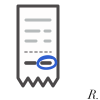
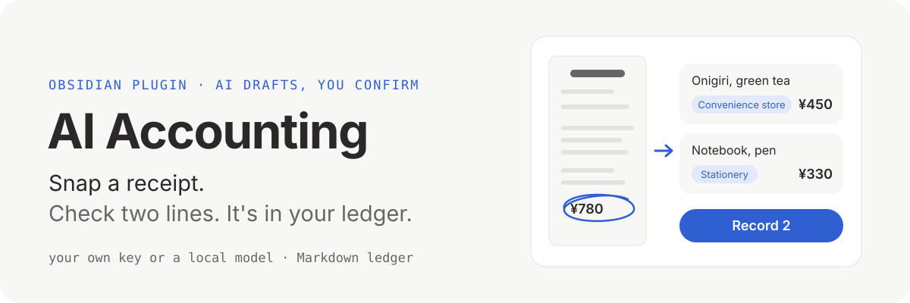
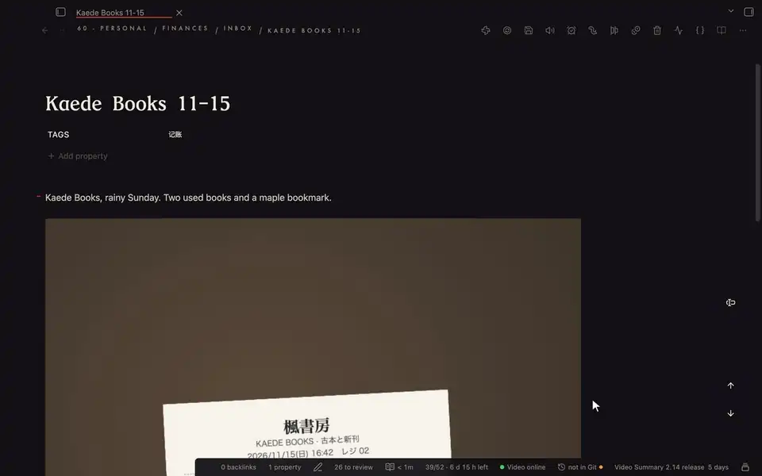
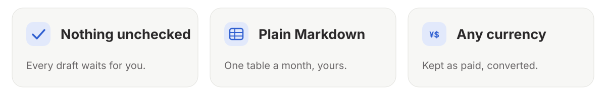
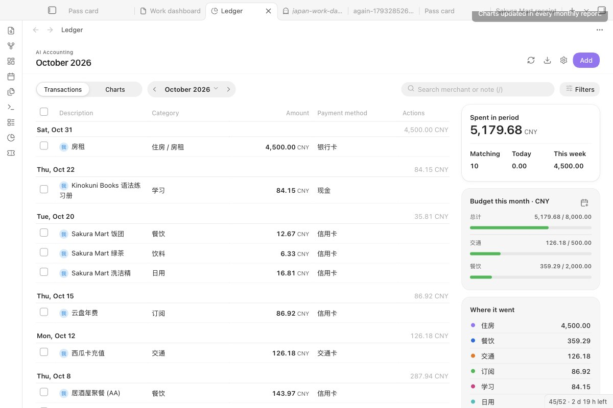
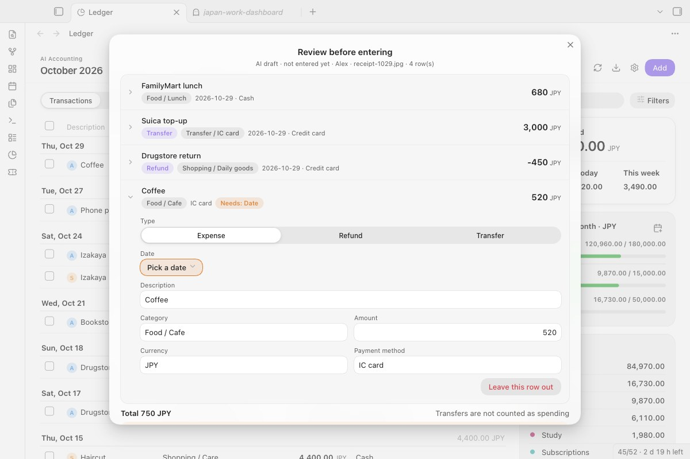
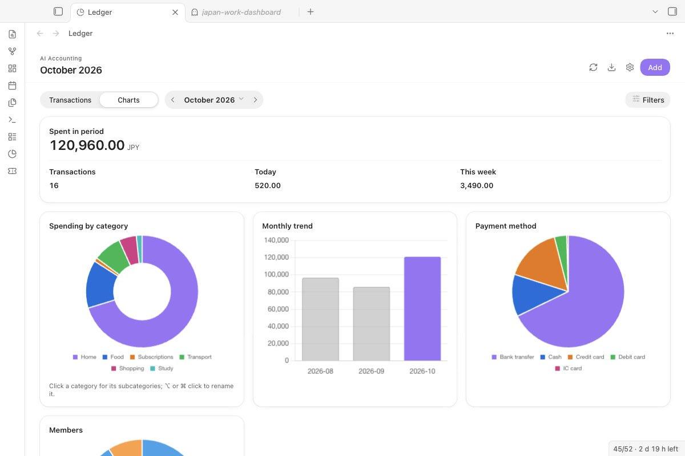
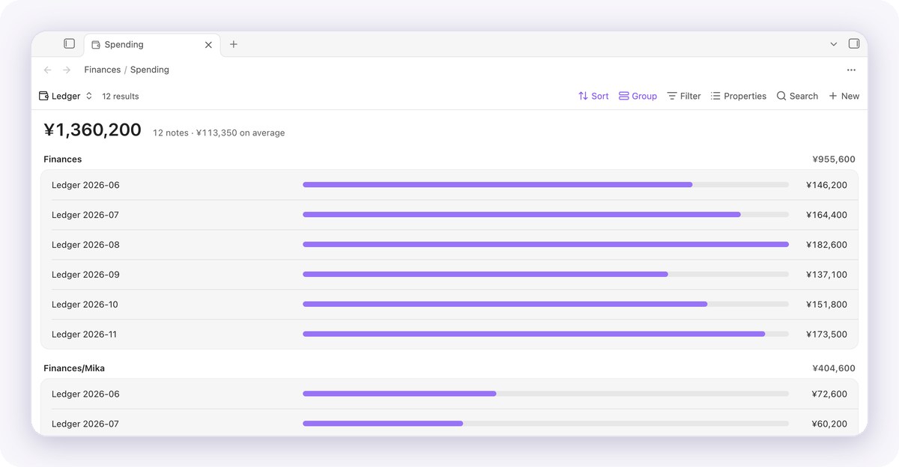
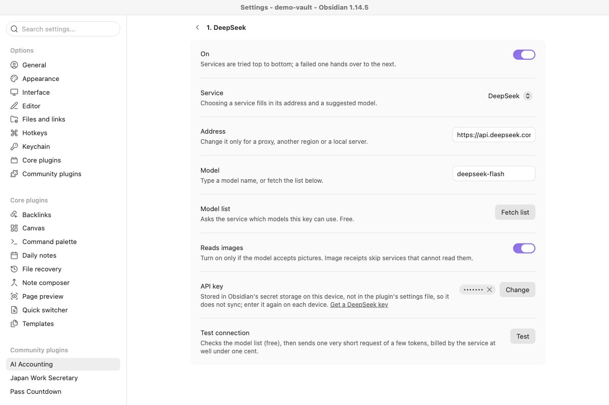

<a href="README.md">English</a> · <a href="README.zh.md">中文</a>

<picture><source media="(prefers-color-scheme: dark)" srcset="assets/readme/icon-dark.svg"></picture>

<picture>
  <source media="(prefers-color-scheme: dark)" srcset="assets/readme/hero-dark.svg">
  
</picture>

<a href="https://community.obsidian.md/plugins/ai-accounting"><b>Obsidian からインストール</b></a>

<picture>
  <source media="(prefers-color-scheme: dark)" srcset="assets/readme/cards-dark.svg">
  
</picture>

## 3 ステップで始める

1. 「Settings → Community plugins → Browse」から **AI Accounting** をインストールして有効にし、左のリボンの円グラフアイコンを押します。
2. **「Settings → AI Accounting → AI services → Add service」** でサービスとキーを選び、**「Test」** を押します。
3. レシート写真を含むノートを開き、**「AI Accounting: Read the current note into the ledger」** を実行します。

AI を設定していない場合は、**「Add」** で手入力するか、空の帳簿で **「Load samples」** を押してください。

**動作環境** Obsidian 1.13 以降。デスクトップとモバイルで使えます。**費用** プラグインは無料です。レシートの読み取りには、自分の API キーかローカルモデルを使います。画面は英語と中国語に対応しています。日本語の Obsidian では英語表示になります。

うまく動かないときは、[AI アシスタントに貼る確認用プロンプト](docs/troubleshooting.ja.md)をどうぞ。

## その他

<b>初回の使い方</b>

1. **AI Accounting** をインストールして有効にし、左のリボンの円グラフアイコンを押します。
2. 空の帳簿で **「Load samples」** を押すと、架空の取引が 3 件（買い物、交通費、返金）表示されます。サンプルと明記され、**「Remove samples」** で削除できます。
3. **「Add」** で支出を手入力します。手入力、グラフ、予算、CSV エクスポートは AI なしで使えます。
4. レシートを読み取るには、**「Settings → AI Accounting → AI services → Add service」** を開きます。初期設定は DeepSeek ですが、他のサービスも選べます。キーを選び、**「Test」** を押してください。

<b>機能一覧</b>

レシート写真やノートから、多通貨の Markdown 帳簿を作ります。AI が下書きを作り、確認してから保存します。

- <b>レシートとノートの読み取り</b>。 写真やノートを受信フォルダーに入れるか、現在のノートでコマンドを実行します。ノート内の画像も読み取り、日付、店舗、分類、金額、通貨、支払方法を入力します。
- <b>確認してから記帳</b>。 読み取った結果は下書きとして保存します。ダイアログを閉じても残り、確定するまでは帳簿に入りません。
- <b>Markdown の帳簿</b>。 保管庫に月ごとの表を保存します。プラグインがなくても読んだり編集したりできます。

<b>記帳</b>

*各行を支出、返金、振替に変更できます。読み違いを直し、不要な行を外してから記帳します。*

- <b>返金と振替</b>。 返金は元の分類に負の金額で記録します。自分の口座間の移動（チャージやカード返済）は最上位の分類「Transfer」または「转账」に入れます。明細には残りますが、支出には含めません。
- <b>重複の確認</b>。 日付、通貨、金額が既存の記録と一致する行には「Maybe already entered」と表示し、行を展開します。記帳対象から外せます。
- <b>下書きの保存</b>。 ダイアログを閉じた下書きは、帳簿の「To review」に残ります。同じレシートを再処理すると下書きを再利用し、AI に再送しません。
- <b>進行状況、キャンセル、再試行</b>。 読み取りの段階と応答中のサービスを表示します。「Cancel」は待機を止め、返信を破棄します。失敗すると原因（キー未設定、認証拒否、残高不足、モデル不明、応答なし）と「Retry」を表示します。未設定の場合は「Open settings」を表示します。
- <b>銀行や決済アプリの明細</b>。 「Import a bank or payment app statement (CSV)」を実行するか、保管庫内の CSV を右クリックします。Alipay、WeChat Pay、日本の銀行やカードの出力、Date / Description / Amount の通常の CSV を端末内で読み取ります。日付と金額はファイルから取得し、AI には任せません。収入は除外し、返金や自分の口座間の振替を判別します。同じ店舗の過去の記帳があれば、その分類を使います。残りの行だけ、説明、金額、通貨、明細内の分類を AI に送ります。AI が提案した分類には印が付き、確認するまで記帳しません。
- <b>多通貨</b>。 各行に元の金額と通貨、為替レート、集計用通貨の金額を残します。オフラインや未対応通貨でレートを取得できない場合は、前回のレートを初期値として手入力できます。
- <b>手入力、割り勘、メンバー</b>。 取引の手入力、メンバー間の均等な割り勘ができます。メンバーごとに帳簿フォルダーと受信フォルダーを設定できます。

<b>確認と計画</b>

*グラフはテーマの配色に合わせます。分類を押すと小分類が表示されます。*

- 日別の明細、検索と絞り込み、編集と削除（削除は 2 回の確認）、帳簿全体の分類名の変更、CSV エクスポート、デイリーノートへの任意のコピーに対応します。狭いペインやスマートフォンでは行をタップして編集します。
- <b>月ごとの予算</b>。 分類ごとに設定でき、帳簿にバーを表示します。80% からオレンジ、超過すると赤になります。
- <b>Bases の帳簿ビュー</b>。 月次帳簿や金額プロパティのあるノートを集めた base で「Ledger」を選ぶと、合計、平均、各ノートの金額バーを集計用通貨で表示します。メンバーフォルダーなどでグループ分けすると、小計も表示します。月次帳簿は `total_expense` を使います。Bases が無効でも、通常の帳簿は使えます。
- <b>定期的な支出</b>。 家賃などを一度設定すれば、毎月、確認画面から記帳できます。同じ月に重ねて記帳しません。

<picture>
  <source media="(prefers-color-scheme: dark)" srcset="assets/readme/bases-dark.png">
  
</picture>

<b>AI サービス</b>

*サービス、アドレス、モデル、キーは別々の欄で設定します。テストで問題の内容を確認できます。*

- <b>プリセット</b>： DeepSeek（初期設定）、Qwen（Alibaba Model Studio）、SiliconFlow、Kimi、Zhipu GLM、Google Gemini、OpenAI、その他の OpenAI 互換サーバーやローカルサーバーに対応します。
- <b>モデル一覧</b>。 キーで使えるモデルをサービスに問い合わせます。生成リクエストは送りません。モデル名は変わるため、一覧から選べます。
- <b>「Reads images」</b>： 画像に対応するモデルだけで有効にします。画像のレシートは、この設定が無効なサービスを使いません。
- <b>接続テスト</b>。 最初にモデル一覧を確認し、次に数トークンの短いリクエストを送ります。生成料金はサービスとモデルによって異なります。

<b>動作環境・費用・データの送信先</b>

| 項目 | 内容 |
|---|---|
| Obsidian | 1.13 以降。デスクトップとモバイルで使えます。 |
| プラグイン | 無料、MIT ライセンスです。独自のアカウントやサーバー、利用状況の収集はありません。 |
| AI モデル | 任意です。自分のキーを使い、送信した分の料金をサービスに支払います。プラグインによる追加料金はありません。レシート 1 枚は通常数千トークンです。OpenAI 互換サーバーで動かすローカルモデルなら、クラウド API の料金はかかりません。 |
| 為替レート | `frankfurter.app` から無料で取得し、プラグインフォルダーにキャッシュします。 |

| データ | 送信先 | タイミング |
|---|---|---|
| 読み取るレシート画像やノートの本文、埋め込み画像 | 設定した AI サービスに一覧の順で送信 | コマンドを実行したとき、またはファイルが受信フォルダーに入ったとき |
| 通貨ペアと日付のみ | `frankfurter.app` | 取引の通貨と集計用通貨が異なるとき |
| モデル一覧のリクエストと、短い「reply with ok」のリクエスト | テスト対象のサービス | **「Test」** を押したとき。「Fetch list」はモデル一覧のリクエストのみ |

これ以外のネットワーク通信は行いません。

- **API キー** は、この端末の Obsidian のシークレットストレージに保存します。設定ファイルにはキー名だけを残すため、キーは保管庫と一緒には同期されません。別の端末では設定で選び直してください。
- **帳簿、下書き、設定** は保管庫内に残ります。帳簿は `Finances/Ledger YYYY-MM.md`（中国語表示では `账本 YYYY-MM.md`）、設定などはプラグインの `data.json` に保存します。帳簿名の接頭辞で月次ノートとの同名を避けます。
- <b>受信フォルダーはすぐに送信します</b>。 設定したフォルダーに画像やテキストを入れると、すぐに AI サービスへ送ります。フォルダーの設定欄を空にすると無効になります。
- <b>明細のインポート</b>。 日付、口座番号、残高、注文番号、収入は端末の外へ送りません。過去に分類した店舗の行も送りません。残りの行は、説明、金額、通貨、明細内の分類だけを送ります。
- <b>複数のサービスへの送信</b>。 最初のサービスが失敗すると、次の有効なサービスを試します。信頼するサービスだけを登録してください。
- **診断情報** は「Test」の横のコピーボタンで取得できます。サービス、アドレス、モデル、処理段階、エラーを含み、キーや帳簿の内容は含みません。
- <b>クリップボード</b>。 このコピーボタンを押したときだけ、診断情報を書き込みます。クリップボードの読み取りは行いません。

<b>手動インストールと更新</b>

<b>Obsidian から</b>： 「Settings → Community plugins → Browse」で **AI Accounting** を検索します。[PKMer](https://github.com/PKM-er/Pkmer-Obsidian) も公式ディレクトリと同期します。

<b>手動</b>： [最新リリース](https://github.com/Rexxall/obsidian-ai-accounting/releases/latest)から `main.js`、`manifest.json`、`styles.css` をダウンロードし、`<vault>/.obsidian/plugins/ai-accounting/` に置きます。Obsidian を再読み込みして有効にします。

<b>ダウンロードの検証</b>： 0.7.2 以降は GitHub Actions でリリースファイルをビルドし、ビルド来歴の署名付き証明を付けています。`gh attestation verify main.js --repo Rexxall/obsidian-ai-accounting` で確認できます。

<b>0.4.0 以前からの更新</b>： ID が `ai-accounting-plugin` から `ai-accounting` に変わりました。新版は初回起動時に旧設定を一度読み込みます。帳簿ノートは変更しません。移行後に旧プラグインを削除してください。

<b>0.5.x からの更新</b>： Gemini と OpenAI 互換エンドポイントを、一つの AI サービス一覧にまとめます。アドレスからサービスを判別し、キーはそのまま引き継ぐため、移行操作は不要です。

<b>仕組み</b>

- **取引ごとに表の 1 行** を使い、末尾に非表示の `<!-- aa:ID -->` を付けます。編集と削除はこの ID で行を探すため、同じコーヒーを 2 回買っても別々の行として残ります。
- <b>セルの処理</b>。 縦線、改行、`<` `>` をエスケープし、店舗名で表が崩れるのを防ぎます。
- <b>古い内容で上書きしません</b>。 ダッシュボードが読み込んだ後に帳簿が変わった場合は、再読み込みを求めます。
- <b>途中まで書き込みません</b>。 全行の換算を済ませてから書き込みます。不足するレートの入力をキャンセルした場合、何も記帳せず下書きを残します。
- <b>元ファイルの保管</b>。 受信ファイルの下書きを記帳すると、ファイルをアーカイブフォルダーに移します。未設定の場合は Obsidian のゴミ箱に移し、完全削除はしません。

<b>制限</b>

- 支出用の帳簿です。収入や口座残高は管理しません。
- 取引を別の月に移すことは、現在できません。
- AI に送るプロンプトの分類名は、初期設定では中国語です。後で変更できます。

<b>開発と変更履歴</b>

ビルド、スタイルの生成、CI、リリース、不具合報告は [CONTRIBUTING.md](CONTRIBUTING.md) を参照してください。

<b>0.8.0</b>： Bases の「Ledger」ビューを追加しました。銀行や決済アプリの CSV 明細は、過去の帳簿の分類を先に使い、残りを AI が提案します。確認してから記帳します。月次帳簿に `账本 YYYY-MM` または `Ledger YYYY-MM` の名前を付け、月次ノートとの重複を避けます。

<b>0.7.2</b>： ノートの埋め込み画像（`![[…]]` または ``、最大 6 枚）を、本文と一緒に画像対応サービスへ送るようになりました。

<b>0.7.1</b>： 為替レートを取得できない場合は手入力できます。設定画面にデータの送信先を明記しました。

<b>0.7.0</b>： コミュニティディレクトリの自動審査の指摘を解消しました。外観は変えていません。

<b>0.6.0</b>： AI サービスを一つの一覧にまとめ、プリセット、モデル一覧、原因を示す接続テストを追加しました。下書きの保存、返金、振替、重複警告、読み取りの進行状況、キャンセルと再試行、サンプルを追加しました。画面は英語と中国語に対応しています。全履歴は [CHANGELOG.md](CHANGELOG.md) を参照してください。

MIT ライセンス
