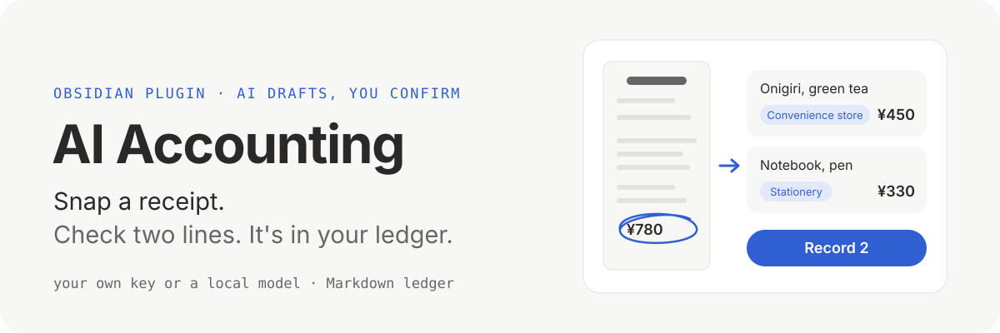
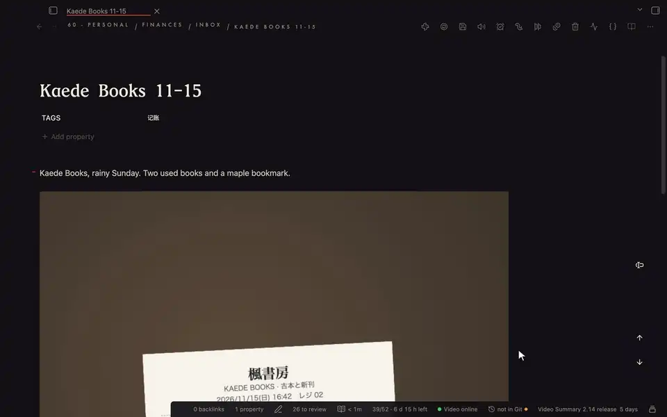
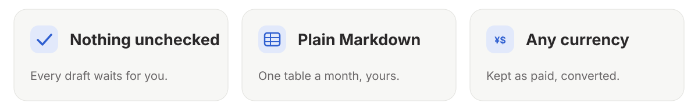
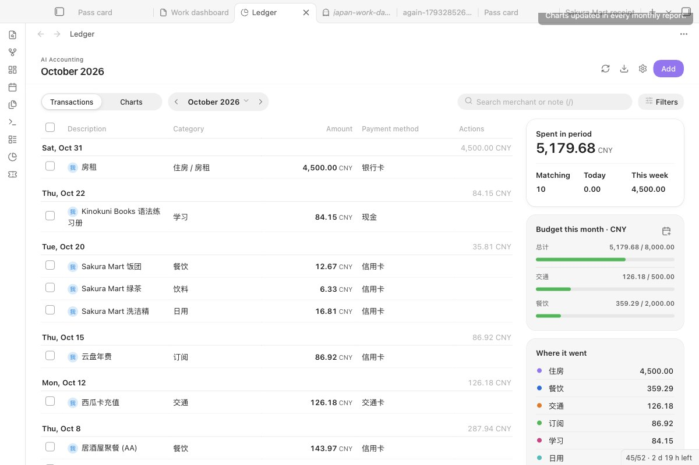
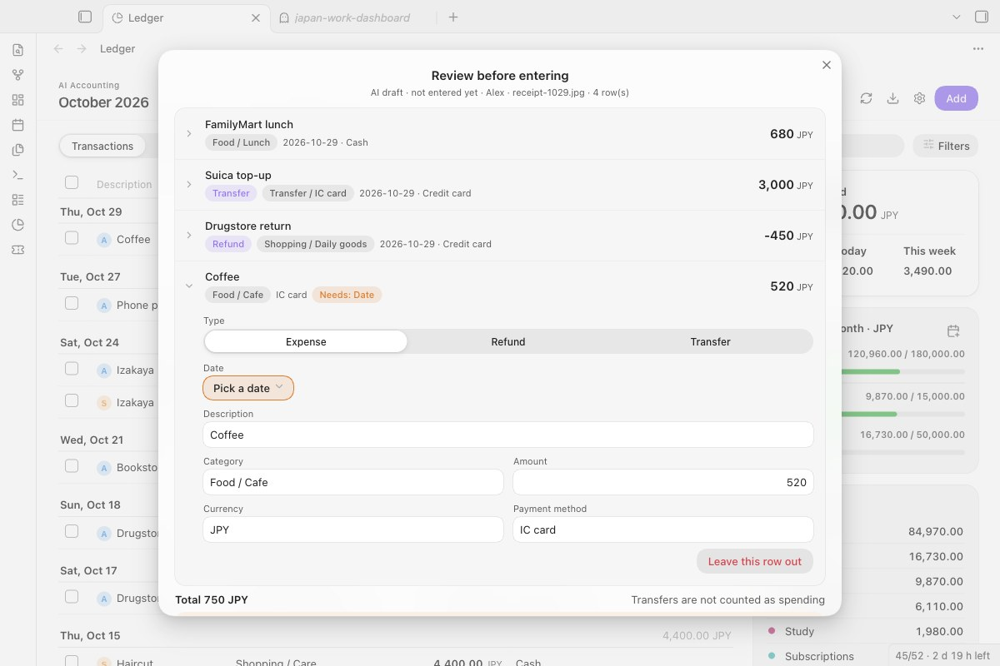
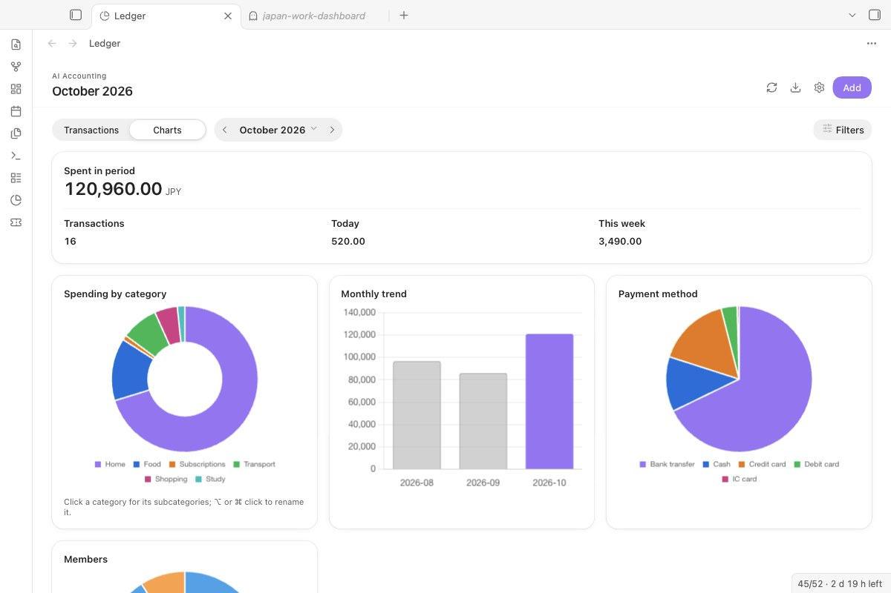
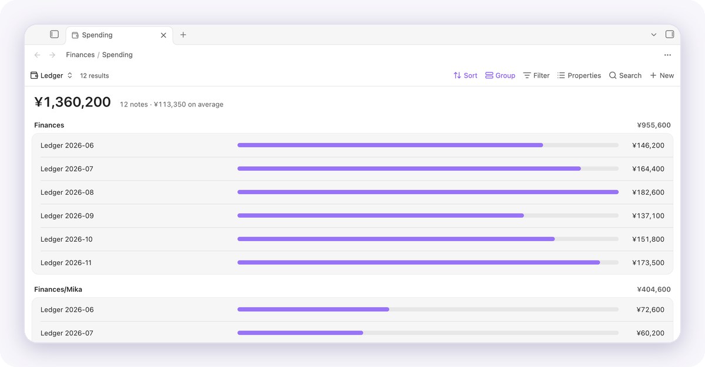
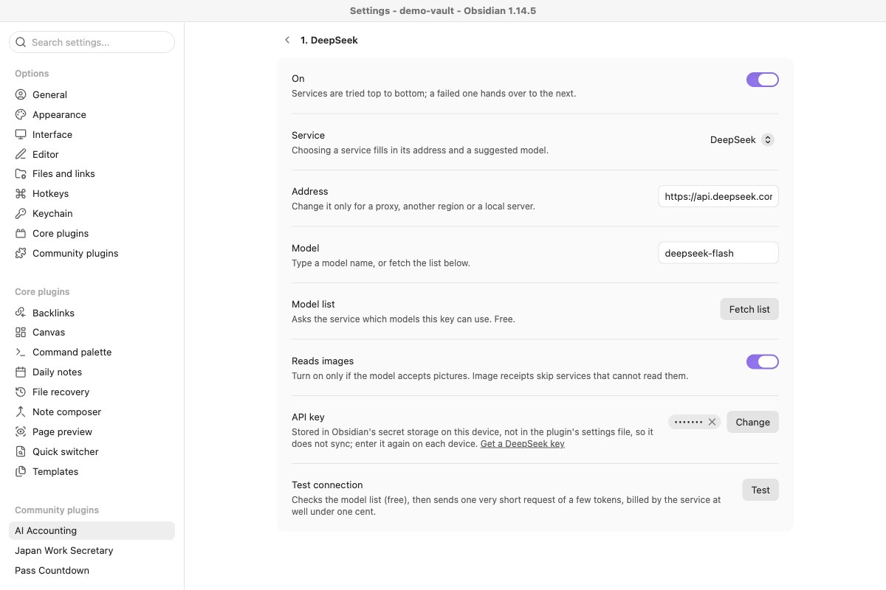

<a href="README.zh.md">中文</a> · <a href="README.ja.md">日本語</a>

<picture><source media="(prefers-color-scheme: dark)" srcset="assets/readme/icon-dark.svg"></picture>

<picture>
  <source media="(prefers-color-scheme: dark)" srcset="assets/readme/hero-dark.svg">
  
</picture>

<a href="https://community.obsidian.md/plugins/ai-accounting"><b>Install from Obsidian</b></a> · <a href="https://rexxall.github.io/ai-accounting/">See how it works</a>

<picture>
  <source media="(prefers-color-scheme: dark)" srcset="assets/readme/cards-dark.svg">
  
</picture>

## Start in three steps

1. Install **AI Accounting** from *Settings → Community plugins → Browse*, enable it and click the pie-chart icon in the left ribbon.
2. In <b>Settings → AI Accounting → AI services → Add service</b>, choose a service and your key, then click <b>Test</b>.
3. Open a note with a receipt photo and run <b>AI Accounting: Read the current note into the ledger</b>.

No AI yet? Click **Add** to record by hand, or **Load samples** on the empty ledger.

**Needs** Obsidian <!-- DOCS-SYNC:START min -->1.13<!-- DOCS-SYNC:END --> or later, desktop or mobile. **Costs** nothing for the plugin; reading receipts uses your own key or a local model. The interface is English or Chinese; other Obsidian languages use English.

Something not working? [Copy a fix-it prompt](docs/troubleshooting.md) for your AI assistant.

## Everything else

<b>First run, step by step</b>

1. Install and enable <b>AI Accounting</b>, then click the pie-chart icon in the left ribbon.
2. On an empty ledger, click <b>Load samples</b>. Three made-up rows appear (a purchase, a fare and a refund), marked as samples; **Remove samples** deletes them.
3. Click **Add** to record your own expense by hand. No AI service is needed for that, or for charts, budgets and CSV export.
4. To read receipts, open <b>Settings → AI Accounting → AI services → Add service</b>. DeepSeek is suggested first; pick another service if you like, choose your key, then click <b>Test</b>.

<b>Every feature</b>

Turn receipt photos and notes into a multi-currency Markdown ledger. The AI drafts each entry, you check it, then it is saved.

- <b>Reads receipts and notes for you</b>. Drop a photo or a note into an inbox folder, or run a command on the current note; receipts embedded in the note are read too. An AI service fills in date, shop, category, amount, currency and payment method.
- <b>Never writes a guess straight into your books</b>. Every result waits as a draft until you check it. Closing the dialog keeps the draft; nothing is entered until you confirm.
- <b>Keeps the books as plain Markdown</b>. One table per month in your vault, readable and editable without the plugin.

<b>Recording</b>

*Every AI result is a draft. Mark a row as expense, refund or transfer, fix what was misread, leave a row out, then enter the rest.*

- <b>Refunds and transfers</b>. A refund is a negative amount in the original category. A transfer between your own accounts (top-ups, card repayments) uses the top-level category *Transfer* (转账); it stays in the list but is not counted as spending.
- <b>Duplicate warning</b>. A drafted row with the same date, currency and amount as a row already in the ledger is marked *Maybe already entered* and opens by itself, so you can leave it out.
- <b>Drafts wait for you</b>. If you close the dialog, the draft is listed on the ledger under *To review*. The same receipt processed again reuses its draft instead of being sent to the AI a second time.
- <b>Progress, Cancel and Retry</b>. While a receipt is read, a notice shows the step and which service is answering. *Cancel* stops waiting and drops the reply; on failure the notice says why (no key, key rejected, out of balance, model not found, no reply in time) and offers *Retry*, or *Open settings* when nothing is set up.
- <b>Statements from your bank or payment app</b>. *Import a bank or payment app statement (CSV)*, or right-click a CSV in the vault. Alipay, WeChat Pay, Japanese bank and card exports and plain Date / Description / Amount files are read on this device: dates and amounts come from the file, never from AI. Income is left out; refunds and moves between your own accounts are recognised. Each row is filed the way you filed the same shop before; only the rest go to your AI service, and only their description, amount, currency and the statement's own category. AI-suggested categories are marked in the review, and nothing is entered until you confirm.
- <b>Multi-currency</b>. Each row keeps its original amount and currency, the rate and the amount in your report currency. When no rate can be fetched (offline, or a currency the rate service does not list), you type it in, starting from the last rate seen.
- <b>Quick entry, split bills, members</b>. Enter a row by hand; split a bill evenly between members; give each member their own ledger folder and inbox.

<b>Reviewing and planning</b>

*Charts follow your theme. Click a category for its subcategories.*

- Ledger grouped by day, search and filters, edit and delete (delete asks twice), rename a category across the ledger, CSV export, optional copy to daily notes. In a narrow pane or on a phone, tap a row to edit it.
- **Monthly budgets** per category, with bars on the ledger page: orange from 80%, red when over.
- <b>Ledger view for Bases</b>. In a base of monthly ledgers (or any notes with an amount), switch the view to *Ledger*: the total, the average and one bar per note in your report currency, with a subtotal for each group when the base is grouped, for example by member folder. Monthly ledgers are picked up by their `total_expense`. With Bases turned off nothing changes.
- **Recurring expenses** such as rent: set once, add each month through the review dialog, never twice in one month.

<picture>
  <source media="(prefers-color-scheme: dark)" srcset="assets/readme/bases-dark.png">
  
</picture>

<b>AI services</b>

*Service, address, model and key are separate. Test tells you exactly what is wrong.*

- <b>Presets</b>: DeepSeek (default), Qwen (Alibaba Model Studio), SiliconFlow, Kimi, Zhipu GLM, Google Gemini, OpenAI, and any other OpenAI-compatible or local server.
- **Model list** asks the service which models your key can use, without a generation request. Model names change often; pick from the list rather than typing.
- <b>Reads images</b>: turn it on only for models that accept pictures. Image receipts skip services without it.
- **Test connection** first checks the model list, then sends one very short request (a few tokens). Generation costs depend on your service and model.

<b>What it needs and where your data goes</b>

| | |
|---|---|
| Obsidian | 1.13 or later, desktop and mobile |
| The plugin | Free, MIT licence. No account, no server of ours, no analytics. |
| AI model | Optional. You use your own key and pay your AI provider for what you send; the plugin adds nothing. A receipt is usually a few thousand tokens. Local models through an OpenAI-compatible server have no cloud API fee. |
| Exchange rates | Free, from `frankfurter.app`, cached in the plugin folder |

| What | Sent to | When |
|---|---|---|
| The receipt image or note text you process, and the images that note embeds | The AI services you set up, in the order listed | When you run the command, or as soon as a file lands in an inbox folder |
| Currency pair and date (nothing else) | `frankfurter.app` | When a row's currency differs from the report currency |
| A request for the model list, then a tiny "reply with ok" request | The service you are testing | Only when you click **Test** (or <b>Fetch list</b>, which sends only the model-list request) |

The plugin makes no other network requests.

- **API keys** live in Obsidian's secret storage on this device. The plugin's settings file keeps only the key's name, so keys are not synced with your vault: on a new device, choose the key again in settings.
- **Ledgers, drafts and settings** stay in your vault (`Finances/Ledger YYYY-MM.md`, or `账本 YYYY-MM.md` with a Chinese interface, and the plugin's `data.json`). The prefix keeps a ledger from sharing its name with a monthly note.
- <b>Inbox folders send right away</b>. While an inbox folder is set, every image or text file put in it goes to the AI service at once. Leave the folder setting blank to turn this off.
- <b>Statement imports send little</b>. Dates, account numbers, balances, order numbers and income never leave the device. Rows your ledger already knows are not sent; for the rest, the AI service gets the description, amount, currency and the statement's own category.
- <b>Several services may see one receipt</b>. If the first service fails, the next enabled one is tried. Keep only services you trust in the list.
- **Diagnostics** (the copy button next to **Test** ) contain the service, address, model, step and error, but no key and no ledger content.
- <b>Clipboard</b>: that copy button is the plugin's only use of the clipboard. It writes the diagnostics when you click it, and the plugin never reads the clipboard.

<b>Install by hand, and upgrading</b>

<b>From Obsidian</b>: Settings → Community plugins → Browse, search for <b>AI Accounting</b>. [PKMer](https://github.com/PKM-er/Pkmer-Obsidian) also syncs the official directory.

<b>Manually</b>: download `main.js`, `manifest.json` and `styles.css` from the [latest release](https://github.com/Rexxall/obsidian-ai-accounting/releases/latest) into `<vault>/.obsidian/plugins/ai-accounting/`, reload Obsidian and enable the plugin.

<b>Checking a download</b>: from 0.7.2 on, GitHub Actions builds the release files and signs where they came from. Check one with `gh attestation verify main.js --repo Rexxall/obsidian-ai-accounting`.

<b>From 0.4.0 or earlier</b>: the id changed from `ai-accounting-plugin` to `ai-accounting`. On first start the new plugin reads the old settings once; your ledger notes are untouched. Then remove the old plugin.

<b>From 0.5.x</b>: Gemini and the OpenAI-compatible endpoints become one list of AI services. Nothing to do: the service each entry belongs to is worked out from its address, and your keys stay where they are.

<b>How it works</b>

- <b>One table row per transaction</b>, ending with a hidden `<!-- aa:ID -->` marker. Edits and deletes find a row by that ID, so two identical coffees stay two rows.
- <b>Safe cells</b>. Pipes, line breaks and `<` `>` are escaped, so a shop name cannot break the table.
- <b>No stale overwrites</b>. If a ledger file changed since the dashboard read it, the plugin asks you to refresh instead of overwriting.
- <b>Nothing half-written</b>. Every row is converted before the first write; if you cancel entering a missing rate, nothing is written and the draft is kept.
- <b>Archiving</b>. Once a draft from an inbox file is entered, the file moves to the archive folder, or to Obsidian's trash if none is set. It is never deleted outright.

<b>Limits</b>

- An expense ledger: income and account balances are not modelled.
- Moving a transaction to another month is blocked for now.
- Category names in the AI prompt are Chinese by default; you can rename categories freely afterwards.

<b>Development and changelog</b>

Build commands, generated styles, CI, releases and issue reporting: [CONTRIBUTING.md](CONTRIBUTING.md).

<b>0.8.0</b>: a *Ledger* view for Bases; bank and payment app statements (CSV) imported with categories filed from your own ledger first and suggested by AI for the rest, reviewed before anything is written; monthly ledgers named `账本 YYYY-MM` so they no longer clash with monthly notes.

<b>0.7.2</b>: receipt images embedded in a note (`![[…]]` or ``, up to six) are sent with its text to services that read images.

<b>0.7.1</b>: when no exchange rate can be fetched, you type it in instead of the entry failing; settings say only what is sent where.

<b>0.7.0</b>: no findings left in the community directory's review, with the same look.

<b>0.6.0</b>: one list of AI services with Chinese presets, a model list and a test that names the problem; drafts that survive closing; refunds, transfers and duplicate warnings; progress with Cancel and Retry; sample rows; English and Chinese interface. Full history in [CHANGELOG.md](CHANGELOG.md).

MIT License
