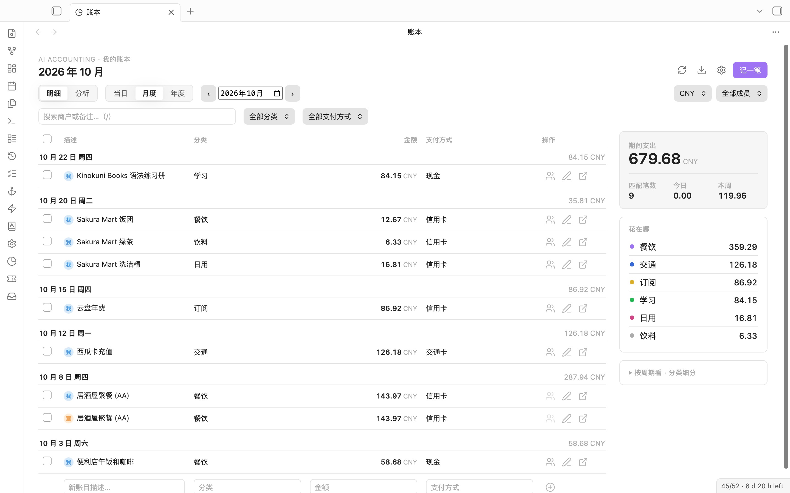

<div align="center">

# AI Accounting for Obsidian

**A multi-currency expense ledger in plain Markdown. Type it or photograph the receipt, check what the AI read, then save.**

用 Markdown 记的多币种账本：打字或拍小票，先核对 AI 读出来的内容，再入账。

[Features](#features) · [Install](#install) · [Privacy](#privacy) · [How it works](#how-it-works) · [中文说明](#中文说明) · [日本語](#日本語)



</div>

## Why

Most expense apps keep your data in their own database, and the ones that read receipts for you save whatever they guessed. This plugin keeps every month as an ordinary Markdown table in your vault, and the AI never writes to it directly: it fills a review form, you correct the rows, and only then are they saved.

## Features

### Recording

- **Quick entry** on the dashboard: amount, description, category, currency, payment method.
- **From text or images.** Run *Process Current Note for Bookkeeping*, or drop a receipt photo or a note into an inbox folder. The AI returns draft rows; you edit date, shop, category, amount, currency and payment method, then confirm.
- **Inbox folders.** One shared inbox, plus an optional inbox per person, so a receipt lands in the right member's ledger.
- **Multi-currency.** Each row keeps its original amount and currency, the rate used, and the amount in your base currency.
- **Split a bill.** Tick *AA/分账* to divide a purchase evenly among the people you set up.


### Reviewing

- **Transactions first.** The dashboard opens on the list for the selected member and period, with search and filters.
- **Charts:** categories (with drill-down into sub-categories), payment methods, monthly trend, and per-member comparison.
- **Edit, re-categorise, rename a category across a year, delete** (delete asks for a second click).
- **Export** the current view as CSV.
- **Daily notes.** Optionally append each day's spending to your daily note.

<picture>
  <source media="(prefers-color-scheme: dark)" srcset="docs/screenshots/charts-dark.jpg">
  
</picture>

### Planning

- **Monthly budgets.** In settings, write one line per category with an amount (`餐饮 40000`), plus `总计` for the whole month. The ledger page shows how much of each budget this month has used: orange from 80%, red when over.
- **Recurring expenses.** Rent, phone, subscriptions: set the amount and the day of the month once. *Add this month's recurring expenses* (or the calendar button on the budget card) opens them in the review dialog; confirm and they are written. Each one has a fixed ID per month, so running it twice adds nothing.

### AI services

- Google Gemini, or any OpenAI-compatible service (OpenAI, a local Ollama, other providers).
- **Several endpoints with fallback.** If the first service fails, the next enabled one is tried.
- **Keys in Obsidian's secret storage.** Pick or create a secret in settings; the plugin's settings keep only its name. Other plugins can use the same secret, so a Gemini key is pasted once.


## Install

**From Obsidian (once listed):** Settings → Community plugins → Browse, search for **AI Accounting**.

**Manually:**

1. Download `main.js`, `manifest.json` and `styles.css` from the latest release.
2. Put them in `<your vault>/.obsidian/plugins/ai-accounting/`.
3. **Settings → Community plugins**, reload, enable **AI Accounting**.
4. Click the pie-chart icon in the left ribbon, or run **AI Accounting: Open dashboard**.

Works on desktop and mobile, Obsidian 1.11.4 or later. The AI features need your own API key.

### Upgrading from 0.4.0 or earlier

Up to 0.4.0 the plugin was called *AI Accounting Plugin* with the id `ai-accounting-plugin`. Community plugin names may not contain "plugin", so from 0.5.0 it is **AI Accounting** with the id `ai-accounting`, which Obsidian treats as a separate plugin.

1. Install 0.5.0 (folder `.obsidian/plugins/ai-accounting/`) and enable it.
2. On first start it reads the settings of the old id once and says so. Your ledgers are ordinary notes and are not touched. API keys move into Obsidian's secret storage.
3. Check that the dashboard shows your ledgers, then disable and remove *AI Accounting Plugin*.

## Privacy

| What | Where it lives |
|---|---|
| Ledgers | Markdown files in your vault, one per month (`Finances/YYYY-MM.md` by default) |
| Settings | This plugin's `data.json` in your vault |
| API keys | Obsidian's secret storage on this device; settings keep only the secret's name |
| Text or images you choose to process | Sent to the AI service you configured when you process a note, or as soon as a file lands in an inbox folder |
| Exchange rates | Requested from `frankfurter.app` and cached in the plugin folder |
| Gemini key | Sent in a request header, never in the URL |

No account, no server of our own, no analytics.

### Network use

- **Inbox folders send files right away.** While an inbox folder is set (the shared one or a member's own), every image or text file that lands in it is sent to the AI service at once, before you see the review dialog. Leave the inbox folder empty to turn this off.
- **Several AI services can see the same receipt.** With more than one service in the list, the plugin tries them in order and moves to the next when one fails, so a receipt may be sent to more than one provider. Keep only the services you trust in the list.
- **Exchange rates** come from `frankfurter.app`: only the currency pair and date are sent. If no rate can be fetched and none is cached, nothing is written and the plugin says so; try again later or enter the amount in the report currency yourself.
- Nothing else leaves your device.

## How it works

- **One table row per transaction.** Each row ends with a hidden `<!-- aa:ID -->` marker. Edits and deletes find a row by that ID, not by matching date and amount, so two identical coffees on the same day stay two rows.
- **Safe cells.** Pipes, line breaks and `<` `>` in a description are escaped before writing and restored when reading, so a shop name cannot break the table.
- **No stale overwrites.** Before editing a row, the plugin checks that the row still reads the way it did when the dashboard loaded. If the file changed in between, it asks you to refresh instead of overwriting.
- **Idempotent imports.** Draft rows from the same source get the same IDs, so processing a receipt twice does not add it twice.
- **Validation.** Dates must be real calendar dates, amounts non-negative, currencies three-letter codes, and rates positive.
- **Archiving.** Processed inbox files are moved to an archive folder; if none is set, they go to Obsidian's trash according to your settings, never deleted outright.

Build from source:

```bash
npm install
npm run build   # type-check and bundle main.js
npm test        # ledger and request tests
npm run lint
```

`styles.css` is generated. Edit `styles/plugin.css` (or the shared glass kit `styles/apple-kit.css` and `styles/ap-helpers.css`, the same in all of my plugins) and run `npm run styles`.

## Known limits

- This is an expense ledger. Income, transfers and account balances are not modelled.
- Editing a transaction into a different month is blocked for now.
- Splitting a bill writes each member's share separately; it is not a single transaction across files.
- The interface is in Chinese.

## Changelog

**0.5.0**

- New look in the style of current Apple apps: solid cards and grouped lists, a glass header bar and glass dialogs, settings drawn as grouped lists, charts in eight distinct colours (the seventh category no longer repeats the first colour). Follows your theme and accent colour; glass turns solid when the system asks for reduced transparency. The paper style option is gone.
- New id `ai-accounting` and name **AI Accounting**, as the community directory requires. Settings from `ai-accounting-plugin` are imported on first start.
- Monthly budgets by category, with a budget card on the ledger page.
- Recurring expenses, added each month through the review dialog and never twice.
- API keys move to Obsidian's secret storage and can be shared with other plugins. Requires Obsidian 1.11.4.
- Settings rebuilt with Obsidian's own section headings, toggles and buttons; no inline styles.
- Fixed: adding an entry from a day's detail in the charts view failed because the exchange rate was saved under the wrong field.
- Model replies are typed and checked; `npm run lint` passes with no errors.
- A quieter ledger header: Ledger and Charts, one month capsule that opens a month picker, a search field, and a single Filter button for day, month or year, currency, member, category and payment method.
- Row actions appear when you point at a row (always shown on touch screens); the member initial shows only in a ledger with more than one member.
- The review dialog lists one line per transaction with the full text; click a line to edit it, and pick the date from a month calendar. Lines with something missing open by themselves.

**0.4.0**

- The ledger reads like a ledger: grouped by day with a total for each day, totals and "where it went" beside it, and the period analysis folded away.
- Two identical purchases on the same day are marked as kept apart on purpose.
- The review window shows the receipt or note next to the draft, marks empty or unreadable cells, and adds up the total.
- Charts take their colours from the theme; the trend highlights the month you are viewing.
- Optional **纸墨风格 (Paper & ink style)** in settings. Off by default, so the dashboard follows your theme.
- Styles rewritten from scratch on a small shared style kit; the dashboard and dialogs no longer use inline styles.

**0.3.0**

- Processed inbox files go to the trash instead of being deleted when no archive folder is set.
- CSV export now escapes quotes correctly.
- AI output is checked before use: a non-text value can no longer end up as `[object Object]` in your ledger.
- Delete asks for a second click instead of a browser dialog.
- The dashboard updates right after an import is confirmed, and charts redraw when you switch between light and dark themes.
- Default Gemini model updated to `gemini-2.5-flash`; the retired 1.5 default is migrated.
- Removed the ribbon button that only showed a notice, unused code and the `lodash` dependency.

**0.2.1** — Review before saving; record IDs; safe Markdown cells; the Gemini key moved from the URL to a header.

## License

MIT

---

## 中文说明

多数记账应用把数据放在自己的数据库里；会读小票的应用，往往直接把猜到的结果存进去。这个插件把每个月存成库里的普通 Markdown 表格，AI 也不会直接写账：它只填一张核对表，你改好每一行再确认入账。

- **录入：** 仪表盘快速录入；对当前笔记或放进收件文件夹的小票照片，AI 先给出草稿，你逐行改日期、商户、分类、金额、币种、支付方式后再确认；可为每位成员设专属收件文件夹。
- **多币种：** 每行保留原币金额、所用汇率和本币金额。
- **分账：** 勾选“AA/分账”，在设置的成员之间平均分摊。
- **查看：** 默认显示明细；分类（可下钻）、支付方式、月度趋势、成员对比图表；编辑、改分类、按年批量改名、删除（需点两次）；导出 CSV；可追加到日记。
- **预算与固定支出（0.5.0）：** 设置里每行写“分类 金额”（加一行“总计”），账本页显示本月各分类用了多少，超 80% 变橙、超出变红；房租、话费等固定支出设一次，每月一键进核对表确认入账，同月不会重复。
- **AI 服务：** Gemini 或任意 OpenAI 兼容服务，多个服务按顺序自动切换；密钥存在 Obsidian 密钥库，可与其他插件共用。
- **联网：** 设了收件文件夹（公用的或成员专属的），文件一放进去就会立即发给 AI 服务，核对表出现在那之后；留空即关闭。配了多个 AI 服务时，一个失败就换下一个，同一张小票可能发给几家服务。汇率向 `frankfurter.app` 查询，只发币种和日期；取不到汇率时不会写入，会提示稍后重试或手动填写。
- **从 0.4.0 升级：** 插件 id 从 `ai-accounting-plugin` 改为 `ai-accounting`（商城不允许名称带 plugin），Obsidian 视为新插件。装好 0.5.0 后首次启动会自动导入旧设置并提示，账本笔记不受影响；确认无误后删除旧版即可。
- **数据安全：** 每笔交易带隐藏标识，按标识编辑；描述里的竖线和换行会安全转义；文件在你打开后被改过就提示刷新，不会覆盖；同一张小票重复处理不会重复入账。

## 日本語

毎月の家計簿を、保管庫の中の普通の Markdown 表として残す多通貨の支出帳です。AI は直接書き込まず、確認フォームに下書きを入れるだけです。日付・店名・分類・金額・通貨・支払方法を直してから記帳します。

- **入力：** ダッシュボードから手入力。ノートやレシート写真を受信フォルダに入れると、AI が下書きを作ります。メンバーごとの受信フォルダも設定できます。
- **多通貨：** 元の金額と通貨、使ったレート、基準通貨での金額を行ごとに保存します。
- **確認：** 明細、分類別（下位分類まで）、支払方法、月別推移、メンバー比較のグラフ。CSV 書き出し、日記への追記にも対応。
- **予算と固定費（0.5.0）：** 分類ごとの月予算と、家賃や通信費など毎月の固定費。固定費は確認画面を通して記帳し、同じ月に二重には入りません。
- **AI：** Gemini または OpenAI 互換サービス。複数のサービスを順に試します。API キーは Obsidian のシークレット保存に置き、他のプラグインと共有できます。
- **通信：** 受信フォルダを設定している間は、ファイルを入れた時点で AI サービスに送信されます（空欄にすると停止）。複数のサービスを登録すると、失敗時に次のサービスへ送るため、同じレシートが複数の事業者に届くことがあります。為替レートは `frankfurter.app` に通貨と日付だけを問い合わせます。
- **0.4.0 からの更新：** ID が `ai-accounting-plugin` から `ai-accounting` に変わりました。初回起動時に旧設定を読み込みます。
- **安全性：** 取引ごとに見えない ID を付けて編集し、表を壊す文字はエスケープします。同じレシートを二度処理しても二重に記帳されません。
