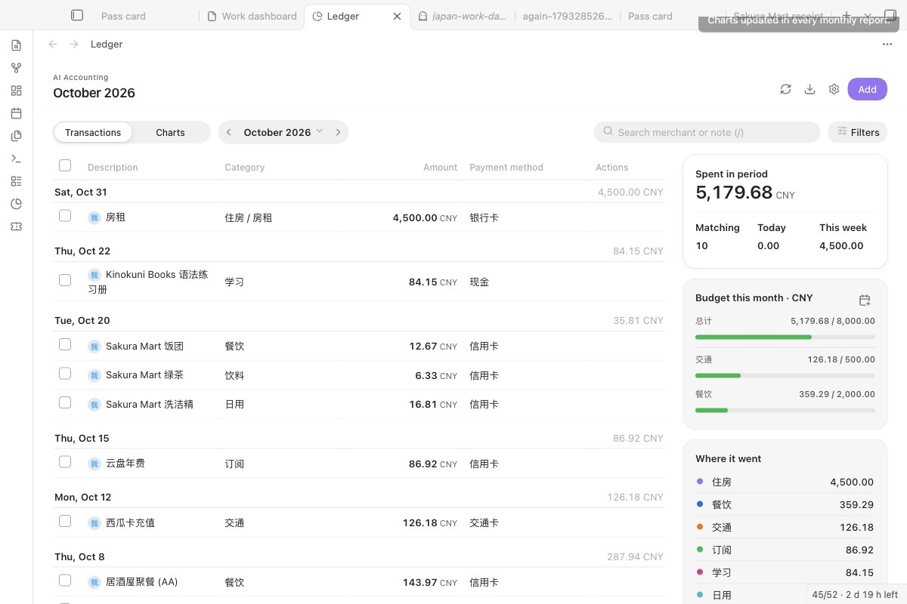
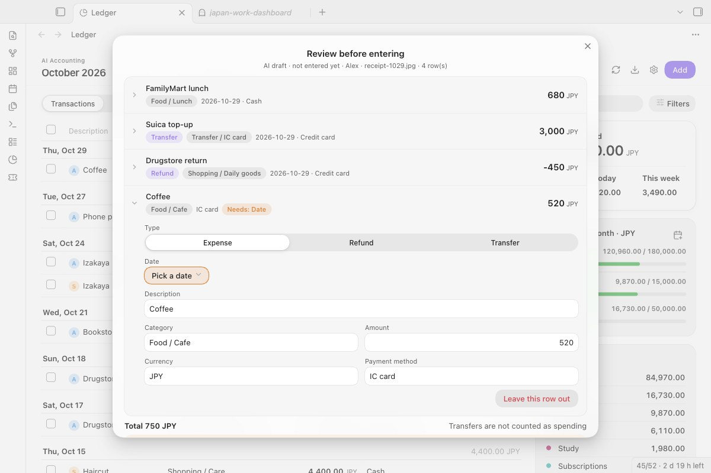
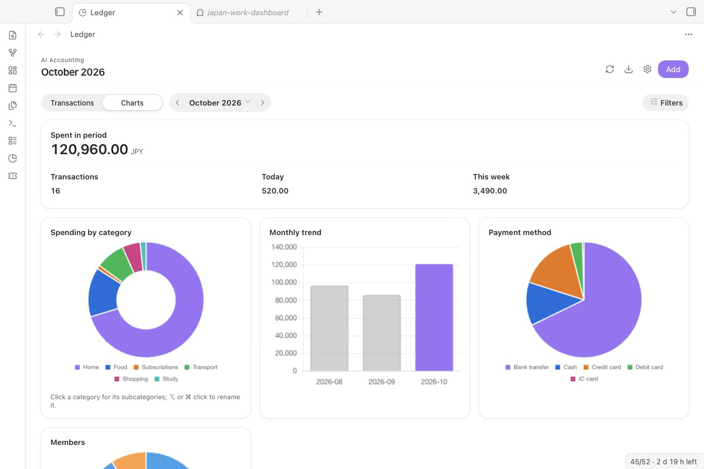
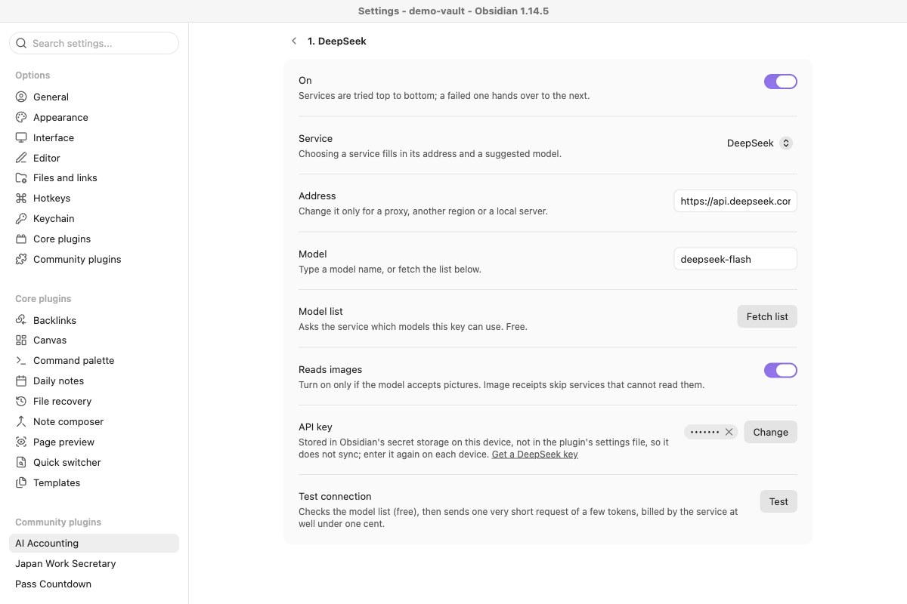

<div align="center">

# AI Accounting

**Turn receipt photos and notes into a multi-currency Markdown ledger. The AI drafts each entry, you check it, then it is saved.**

[中文说明 →](README.zh.md) · [日本語](#日本語)



</div>

## What it does

- **Reads receipts and notes for you.** Drop a photo or a note into an inbox folder, or run a command on the current note. An AI service fills in date, shop, category, amount, currency and payment method.
- **Never writes a guess straight into your books.** Every result waits as a draft until you check it. Closing the dialog keeps the draft; nothing is entered until you confirm.
- **Keeps the books as plain Markdown.** One table per month in your vault, readable and editable without the plugin.

## Start here

1. Install and enable **AI Accounting**, then click the pie-chart icon in the left ribbon.
2. On an empty ledger, click **Load samples**. Three made-up rows appear (a purchase, a fare and a refund), marked as samples; **Remove samples** deletes them.
3. Click **Add** to record your own expense by hand. No AI service is needed for that, or for charts, budgets and CSV export.
4. To read receipts, open **Settings → AI Accounting → AI services → Add service**. DeepSeek is suggested first; pick another service if you like, choose your key, then click **Test**.

## What it needs and what it costs

| | |
|---|---|
| Obsidian | 1.13 or later, desktop and mobile |
| The plugin | Free, MIT licence. No account, no server of ours, no analytics. |
| AI model | Optional. You use your own key and pay your AI provider for what you send; the plugin adds nothing. A receipt is usually a few thousand tokens. Local models through an OpenAI-compatible server cost nothing. |
| Exchange rates | Free, from `frankfurter.app`, cached in the plugin folder |

## Where your data goes

| What | Sent to | When |
|---|---|---|
| The receipt image or note text you process | The AI services you set up, in the order listed | When you run the command, or as soon as a file lands in an inbox folder |
| Currency pair and date (nothing else) | `frankfurter.app` | When a row's currency differs from the report currency |
| A tiny "reply with ok" request | The service you are testing | Only when you click **Test** |

- **API keys** live in Obsidian's secret storage on this device. The plugin's settings file keeps only the key's name, so keys are not synced with your vault: on a new device, choose the key again in settings.
- **Ledgers, drafts and settings** stay in your vault (`Finances/YYYY-MM.md` and the plugin's `data.json`).
- **Inbox folders send right away.** While an inbox folder is set, every image or text file put in it goes to the AI service at once. Leave the folder empty to turn this off.
- **Several services may see one receipt.** If the first service fails, the next enabled one is tried. Keep only services you trust in the list.
- **Diagnostics** (the copy button next to **Test**) contain the service, address, model, step and error, but no key and no ledger content.

## Recording



*Every AI result is a draft. Mark a row as expense, refund or transfer, fix what was misread, leave a row out, then enter the rest.*

- **Refunds and transfers.** A refund is a negative amount in the original category. A transfer between your own accounts (top-ups, card repayments) uses the top-level category *Transfer* (转账); it stays in the list but is not counted as spending.
- **Duplicate warning.** A drafted row with the same date, currency and amount as a row already in the ledger is marked *Maybe already entered* and opens by itself, so you can leave it out.
- **Drafts wait for you.** If you close the dialog, the draft is listed on the ledger under *To review*. The same receipt processed again reuses its draft instead of being sent to the AI a second time.
- **Progress, Cancel and Retry.** While a receipt is read, a notice shows the step and which service is answering. *Cancel* stops waiting and drops the reply; on failure the notice says why (no key, key rejected, out of balance, model not found, no reply in time) and offers *Retry*, or *Open settings* when nothing is set up.
- **Multi-currency.** Each row keeps its original amount and currency, the rate and the amount in your report currency.
- **Quick entry, split bills, members.** Enter a row by hand; split a bill evenly between members; give each member their own ledger folder and inbox.

## Reviewing and planning



*Charts follow your theme. Click a category for its subcategories.*

- Ledger grouped by day, search and filters, edit and delete (delete asks twice), rename a category across the ledger, CSV export, optional copy to daily notes. In a narrow pane or on a phone, tap a row to edit it.
- **Monthly budgets** per category, with bars on the ledger page: orange from 80%, red when over.
- **Recurring expenses** such as rent: set once, add each month through the review dialog, never twice in one month.

## AI services



*Service, address, model and key are separate. Test tells you exactly what is wrong.*

- **Presets:** DeepSeek (default), Qwen (Alibaba Model Studio), SiliconFlow, Kimi, Zhipu GLM, Google Gemini, OpenAI, and any other OpenAI-compatible or local server.
- **Model list** asks the service which models your key can use (free). Model names change often; pick from the list rather than typing.
- **Reads images:** turn it on only for models that accept pictures. Image receipts skip services without it.
- **Test connection** first checks the model list (free), then sends one very short request (a few tokens, well under one cent).

## Install

**From Obsidian (once listed):** Settings → Community plugins → Browse, search for **AI Accounting**.

**Manually:** download `main.js`, `manifest.json` and `styles.css` from the latest release into `<vault>/.obsidian/plugins/ai-accounting/`, reload Obsidian and enable the plugin.

**From 0.4.0 or earlier:** the id changed from `ai-accounting-plugin` to `ai-accounting`. On first start the new plugin reads the old settings once; your ledger notes are untouched. Then remove the old plugin.

**From 0.5.x:** Gemini and the OpenAI-compatible endpoints become one list of AI services. Nothing to do: the service each entry belongs to is worked out from its address, and your keys stay where they are.

## How it works

- **One table row per transaction**, ending with a hidden `<!-- aa:ID -->` marker. Edits and deletes find a row by that ID, so two identical coffees stay two rows.
- **Safe cells.** Pipes, line breaks and `<` `>` are escaped, so a shop name cannot break the table.
- **No stale overwrites.** If a ledger file changed since the dashboard read it, the plugin asks you to refresh instead of overwriting.
- **Nothing half-written.** Every row is converted before the first write; if a rate is missing, nothing is written and the draft is kept.
- **Archiving.** Once a draft from an inbox file is entered, the file moves to the archive folder, or to Obsidian's trash if none is set. It is never deleted outright.

```bash
npm install
npm run build   # type-check and bundle main.js
npm test        # ledger, migration, AI service and request tests
npm run lint
```

`styles.css` is generated: edit `styles/plugin.css` and run `npm run styles`.

## Known limits

- An expense ledger: income and account balances are not modelled.
- Moving a transaction to another month is blocked for now.
- Category names in the AI prompt are Chinese by default; you can rename categories freely afterwards.

## Changelog

**0.6.0:** one list of AI services with Chinese presets, a model list and a test that names the problem; drafts that survive closing; refunds, transfers and duplicate warnings; progress with Cancel and Retry; sample rows; English and Chinese interface. Full history in [CHANGELOG.md](CHANGELOG.md).

## License

MIT

---

## 日本語

レシート写真やノートを、多通貨の Markdown 家計簿に変えます。AI が下書きを作り、あなたが確認してから記帳します。下書きは閉じても残り、確定するまで帳簿には入りません。AI サービスは DeepSeek、通義、SiliconFlow、Kimi、智譜、Gemini、OpenAI、ローカルサーバーから選べ、接続テストで原因（キーなし、認証失敗、残高不足、モデルなし、タイムアウト）を表示します。API キーはこの端末の Obsidian シークレット保存にあり、同期されません。プラグインは無料で、AI の利用料は各サービスに直接支払います。
