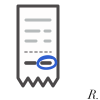
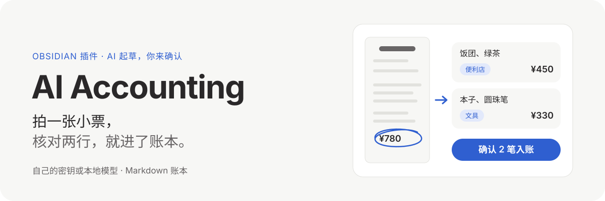
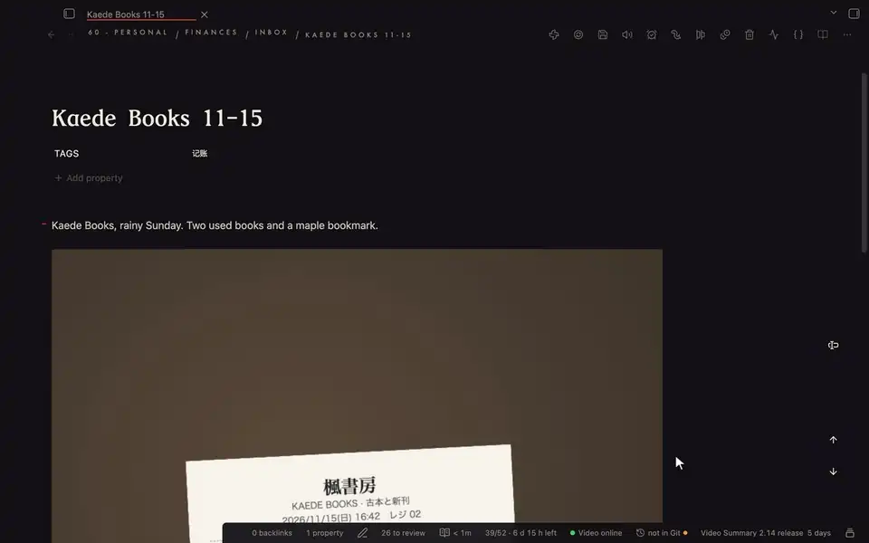
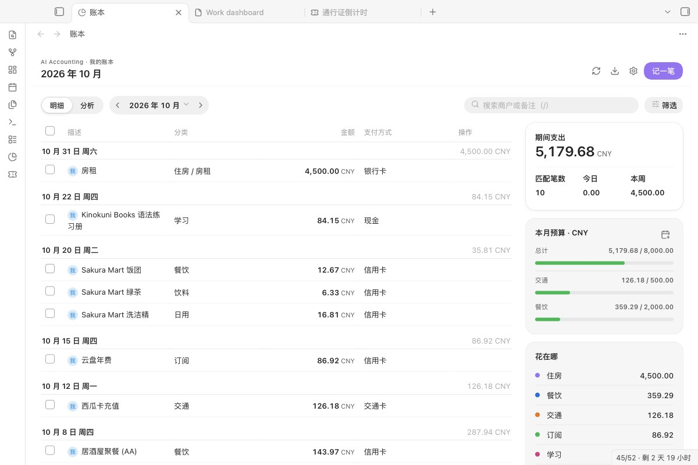
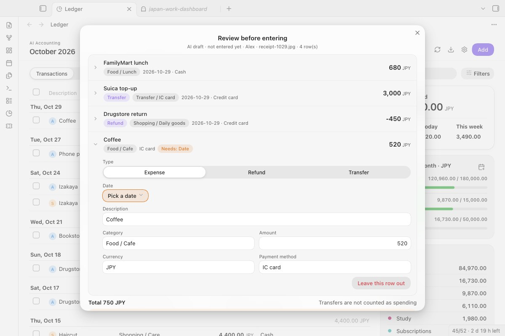
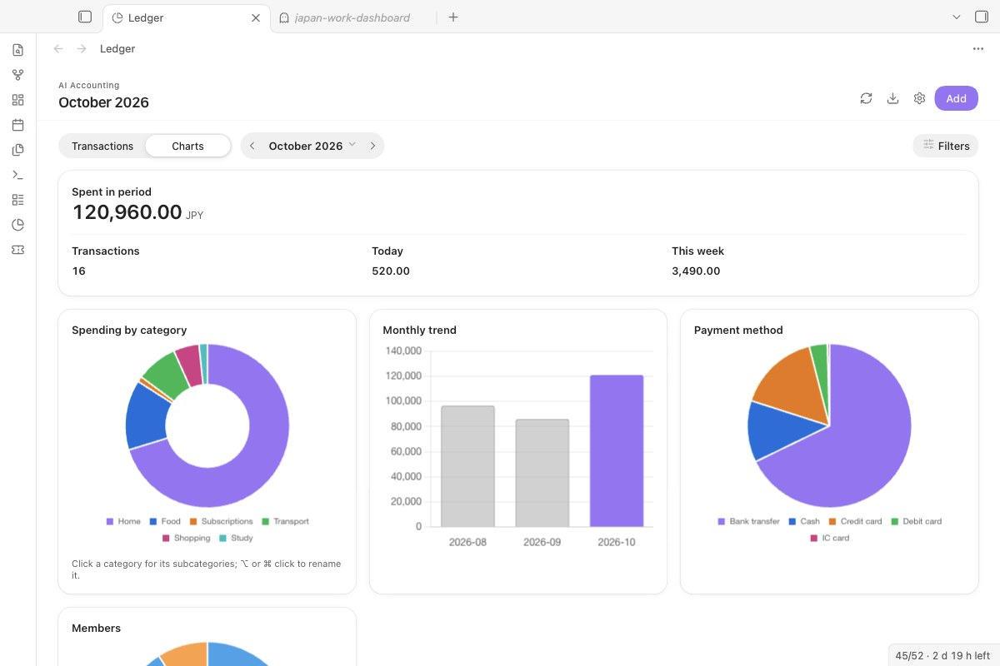
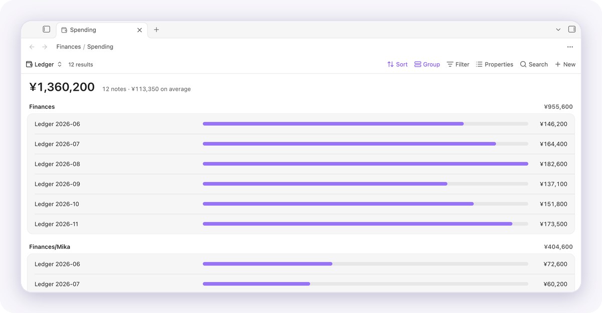
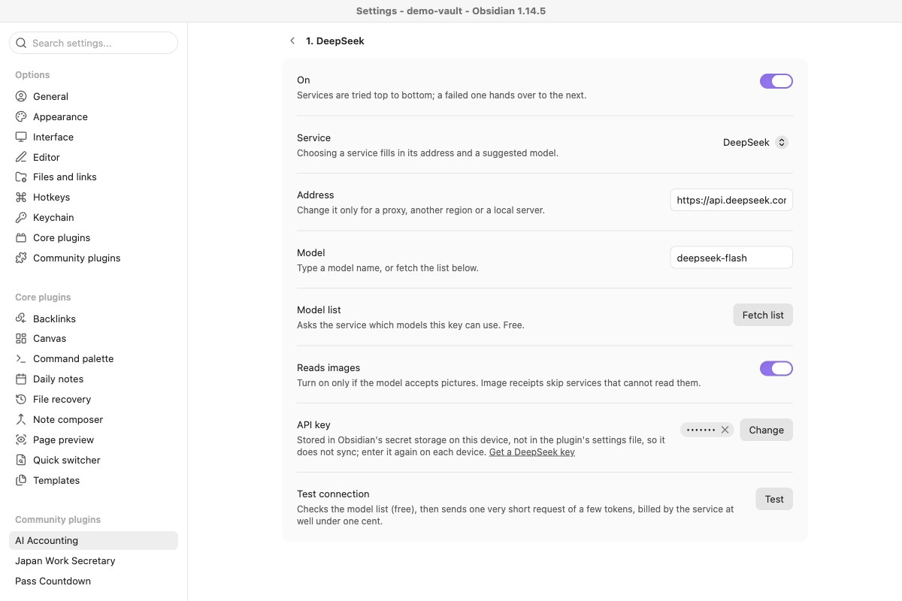

<a href="README.md">English</a> · <a href="README.ja.md">日本語</a>

<picture><source media="(prefers-color-scheme: dark)" srcset="assets/readme/icon-dark.svg"></picture>

<picture>
  <source media="(prefers-color-scheme: dark)" srcset="assets/readme/hero-zh-dark.svg">
  
</picture>

<a href="https://community.obsidian.md/plugins/ai-accounting"><b>在 Obsidian 里安装</b></a> · <a href="https://rexxall.github.io/ai-accounting/">看它怎么用</a>

<picture>
  <source media="(prefers-color-scheme: dark)" srcset="assets/readme/cards-zh-dark.svg">
  
</picture>

## 三步上手

1. 在 *设置 → 第三方插件 → 浏览* 里安装并启用 <b>AI Accounting</b>， 点左侧栏的饼图图标。
2. 在 **设置 → AI Accounting → AI 服务 → 添加服务** 里选服务和密钥，点 <b>测试</b>。
3. 打开一篇带小票照片的笔记，运行 <b>AI Accounting: 识别当前笔记并记账</b>。

还没有 AI？点 **记一笔** 手动记，或在空账本里点 <b>载入示例</b>。

**需要** Obsidian <!-- DOCS-SYNC:START min -->1.13<!-- DOCS-SYNC:END --> 或更高，电脑和手机都能用。**花费** 插件免费；识别小票用你自己的密钥或本地模型。界面支持中英双语，Obsidian 设为其他语言时显示英文。

遇到问题？[复制一段排查提示词](docs/troubleshooting.zh-CN.md) 给你的 AI 助手。

## 其余内容

<b>第一次使用的完整步骤</b>

1. 安装并启用 <b>AI Accounting</b>， 点左侧栏的饼图图标打开账本。
2. 账本是空的时候，点 <b>载入示例</b>。 会出现三笔虚构的账目（一笔消费、一笔车费、一笔退款），标着【示例】；点 **删除示例** 删掉。
3. 点 **记一笔** 手动记自己的账。手动记账、图表、预算和导出 CSV 都不需要 AI。
4. 想识别小票：打开 <b>设置 → AI Accounting → AI 服务 → 添加服务</b>。 默认是 DeepSeek，也可以换别家；选好密钥后点 <b>测试</b>。

<b>全部功能</b>

把小票照片和笔记变成多币种的 Markdown 账本：AI 先起草，你核对，确认后才入账。

- <b>替你读小票和笔记</b>。 把照片或笔记放进收件箱文件夹，或者对当前笔记运行命令（笔记里嵌入的小票图片也会读），AI 会填好日期、商户、分类、金额、币种和支付方式。
- <b>猜的东西不会直接进账</b>。 每次识别结果都先存成草稿，等你核对。关掉窗口草稿也还在，只有点了确认才入账。
- <b>账本就是普通 Markdown</b>。 每月一张表，放在你的库里，不装插件也能看、能改。

<b>记账</b>

*AI 的结果都是草稿。可以把一行改成支出、退款或转账，改正读错的地方，去掉某一行，再把其余的入账。*

- <b>退款和转账</b>。 退款记成原分类下的负数。在自己账户之间转钱（充值、还信用卡）用一级分类“转账”，会列在账本里，但不算支出。
- <b>重复提示</b>。 草稿里和账本已有记录日期、币种、金额都相同的行，会标“可能已记过”并自动展开，方便你去掉。
- <b>草稿会等你</b>。 关掉窗口后，草稿会列在账本页的“待确认”里。同一张小票再处理一次，会直接用原来的草稿，不会再发给 AI。
- <b>进度、取消、重试</b>。 识别时会显示进行到哪一步、哪家服务在回复。“取消”会停止等待并丢掉回复；失败时会说明原因（没填密钥、密钥被拒、余额不足、模型不存在、没有回复），并给“重试”；什么都没设置时给“打开设置”。
- <b>导入银行和支付软件的账单</b>。 运行“导入银行或支付软件账单（CSV）”，或在库里右键一个 CSV。支付宝、微信支付、日本银行和信用卡的导出文件，以及只有日期、描述、金额三列的普通文件，都在本机读取：日期和金额直接取自文件，不经过 AI。收入不导入；退款和自己账户之间的转账会认出来。以前记过的店，按你当时的分类自动填；其余的才发给你设置的 AI 服务，而且只发描述、金额、币种和账单自带的分类。AI 建议的分类在核对窗口里有标记，你确认之前一笔都不写入。
- <b>多币种</b>。 每行保留原币金额和币种、所用汇率和报表币种金额。取不到汇率时（没联网，或汇率服务不提供这种币种），可以手动填写，默认先填上次用过的汇率。
- <b>手动录入、分账、多成员</b>。 可以手动记一笔，在成员之间平摊，每位成员有自己的账本文件夹和收件箱。

<b>查看和计划</b>

*图表跟随主题配色。点分类可以看子分类。*

- 按天分组的明细、搜索和筛选、编辑和删除（删除要点两次）、整本账改分类名、导出 CSV、可同步到日记。窄栏和手机上点一行就能编辑。
- **月度预算** 按分类设置，账本页显示进度：超过 80% 变橙，超出变红。
- <b>Bases 账本视图</b>。 在放月账本（或任何带金额属性的笔记）的 base 里，把视图换成“账本”：显示合计、平均，每篇笔记一条按报表币种画的横条；base 分了组（比如按成员文件夹）时，每组给出小计。月账本自动用它的 `total_expense`。没开 Bases 时一切照旧。
- **固定支出** （如房租）设一次，每月通过核对窗口入账，同一个月不会重复。

<picture>
  <source media="(prefers-color-scheme: dark)" srcset="assets/readme/bases-dark.png">
  
</picture>

<b>AI 服务</b>

*服务商、地址、模型、密钥分开填。测试会直接告诉你哪里不对。*

- <b>预设</b>： DeepSeek（默认）、通义千问（阿里云百炼）、硅基流动、Kimi、智谱 GLM、Google Gemini、OpenAI，以及其他 OpenAI 兼容服务或本地服务。
- **模型列表** 向服务商查询你的密钥能用哪些模型，不发送生成请求。模型名经常变，建议从列表里选，不要手打。
- <b>能识图</b>： 只给支持图片的模型打开。图片小票会跳过没打开的服务。
- **测试连接** 先查模型列表，再发一条只有几个 token 的请求。生成费用取决于服务商和模型。

<b>需要什么、数据去哪里</b>

| | |
|---|---|
| Obsidian | 1.13 或更高，电脑和手机都能用 |
| 插件本身 | 免费，MIT 许可。不用注册，没有我们自己的服务器，不做统计。 |
| AI 模型 | 可不用。用你自己的密钥，按用量直接付给 AI 服务商，插件不加价。一张小票通常几千个 token。通过 OpenAI 兼容服务跑本地模型，不产生云端 API 费用。 |
| 汇率 | 免费，来自 `frankfurter.app`，缓存在插件文件夹里 |

| 什么 | 发给谁 | 什么时候 |
|---|---|---|
| 你要识别的小票图片或笔记文字，以及笔记里嵌入的图片 | 你设置的 AI 服务，按列表顺序 | 运行命令时，或文件一放进收件箱文件夹时 |
| 币种和日期（只有这两项） | `frankfurter.app` | 账目币种和报表币种不同时 |
| 先查一次模型列表，再发一条“回复 ok”的极短请求 | 正在测试的服务 | 只在你点 **测试** 时（点 **获取列表** 只发查模型列表的请求） |

除此之外，插件不发任何网络请求。

- **API 密钥** 存在本机 Obsidian 的密钥库里。插件设置文件里只记密钥的名字，所以密钥不会随库同步：换设备后要在设置里重新选一次。
- **账本、草稿和设置** 都留在你的库里（中文界面下为 `Finances/账本 YYYY-MM.md`，英文界面下为 `Finances/Ledger YYYY-MM.md`，以及插件的 `data.json`）。文件名带“账本”前缀，免得和月记同名。
- <b>收件箱会立即发送</b>。 设了收件箱文件夹，放进去的图片和文本会马上发给 AI 服务。文件夹设置留空即关闭。
- <b>导入账单发出去的很少</b>。 日期、账号、余额、订单号和收入都不离开本机。以前记过的店不发送；其余每笔只发描述、金额、币种和账单自带的分类。
- <b>一张小票可能发给几家服务</b>。 第一家失败会换下一家启用的服务。列表里只留你信任的服务。
- **诊断信息** （“测试”旁边的复制按钮）包含服务、地址、模型、出错的步骤和原因，不含密钥，也不含账目内容。
- <b>剪贴板</b>： 插件只在这个复制按钮上用剪贴板：你点它时写入诊断信息。插件从不读取剪贴板。

<b>手动安装和升级</b>

<b>在 Obsidian 里安装</b>： 设置 → 第三方插件 → 浏览，搜索 <b>AI Accounting</b>。 [PKMer](https://github.com/PKM-er/Pkmer-Obsidian) 会自动同步官方目录。

<b>手动</b>： 从 [最新版本](https://github.com/Rexxall/obsidian-ai-accounting/releases/latest) 下载 `main.js`、`manifest.json`、`styles.css`，放进 `<库>/.obsidian/plugins/ai-accounting/`，重新加载后启用。

<b>核验下载</b>： 从 0.7.2 起，Release 附件由 GitHub Actions 构建并附构建来源认证，可以用 `gh attestation verify main.js --repo Rexxall/obsidian-ai-accounting` 核验。

<b>从 0.4.0 或更早升级</b>： 插件 id 从 `ai-accounting-plugin` 改成了 `ai-accounting`。新插件首次启动会读一次旧设置，账本笔记不受影响，之后删掉旧插件即可。

<b>从 0.5.x 升级</b>： Gemini 和 OpenAI 兼容接口合成一张“AI 服务”列表。不用做什么：每一项属于哪家服务会按地址自动判断，密钥也留在原处。

<b>原理</b>

- <b>每笔交易一行</b>， 行尾带隐藏的 `<!-- aa:ID -->` 标记。编辑和删除按标记找行，同一天两杯一样的咖啡仍是两行。
- <b>单元格安全</b>。 竖线、换行和 `<` `>` 都会转义，商户名不会弄坏表格。
- <b>不覆盖过期内容</b>。 账本文件在你打开后被改过，会提示刷新，不会覆盖。
- <b>不会只写一半</b>。 所有行先换算好才写入；取不到汇率又取消填写时，一行也不写，草稿保留。
- <b>归档</b>。 收件箱文件的草稿入账后，文件移到归档文件夹；没设归档就移到 Obsidian 回收站，不会直接删除。

<b>已知限制</b>

- 这是支出账本，不记收入和账户余额。
- 暂时不能把一笔交易改到别的月份。
- 发给 AI 的提示词里默认用中文分类名，之后可以随意改名。

<b>开发和更新记录</b>

构建、样式生成、CI、发布和提 issue 的方式见 [CONTRIBUTING.md](CONTRIBUTING.md)。

<b>0.8.0</b>： Bases“账本”视图；导入银行和支付软件账单（CSV），先按你以前的记账分类，其余由 AI 建议，核对后才写入；月账本改名为 `账本 YYYY-MM`（英文界面为 `Ledger YYYY-MM`），不再和月记同名。

<b>0.7.2</b>： 笔记里嵌入的小票图片（`![[…]]` 或 ``，最多六张）会和正文一起发给能读图的服务。

<b>0.7.1</b>： 取不到汇率时可以手动填写，不再入账失败；设置里只说明数据会发给谁。

<b>0.7.0</b>： 社区目录的自动审查不再有提示，外观不变。

<b>0.6.0</b>： AI 服务合成一张列表，带国内服务商预设、模型列表和能说清原因的测试；草稿关掉也不丢；支持退款、转账和重复提示；识别有进度、可取消、可重试；可载入示例；界面支持中英双语。完整记录见 [CHANGELOG.md](CHANGELOG.md)。

MIT 许可
