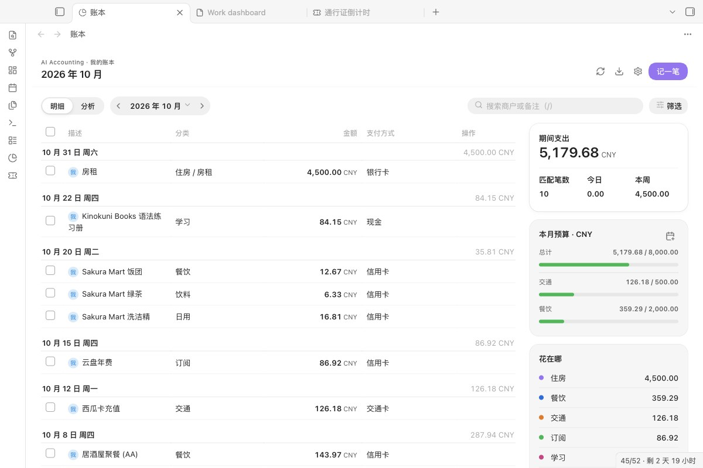

# AI Accounting（AI 记账）

**把小票照片和笔记变成多币种的 Markdown 账本：AI 先起草，你核对，确认后才入账。**

[English →](README.md)

## 能做什么

- **替你读小票和笔记。** 把照片或笔记放进收件箱文件夹，或者对当前笔记运行命令，AI 会填好日期、商户、分类、金额、币种和支付方式。
- **猜的东西不会直接进账。** 每次识别结果都先存成草稿，等你核对。关掉窗口草稿也还在，只有点了确认才入账。
- **账本就是普通 Markdown。** 每月一张表，放在你的库里，不装插件也能看、能改。

## 从这里开始

1. 安装并启用 **AI Accounting**，点左侧栏的饼图图标打开账本。
2. 账本是空的时候，点 **载入示例**。会出现三笔虚构的账目（一笔消费、一笔车费、一笔退款），标着【示例】；点 **删除示例** 一键删掉。
3. 点 **记一笔** 手动记自己的账。手动记账、图表、预算和导出 CSV 都不需要 AI。
4. 想识别小票：打开 **设置 → AI Accounting → AI 服务 → 添加服务**。默认是 DeepSeek，也可以换别家；选好密钥后点 **测试**。

## 需要什么、花多少钱

| | |
|---|---|
| Obsidian | 1.13 或更高，电脑和手机都能用 |
| 插件本身 | 免费，MIT 许可。不用注册，没有我们自己的服务器，不做统计。 |
| AI 模型 | 可不用。用你自己的密钥，按用量直接付给 AI 服务商，插件不加价。一张小票通常几千个 token。通过 OpenAI 兼容服务跑本地模型则不花钱。 |
| 汇率 | 免费，来自 `frankfurter.app`，缓存在插件文件夹里 |

## 数据去哪里

| 什么 | 发给谁 | 什么时候 |
|---|---|---|
| 你要识别的小票图片或笔记文字 | 你设置的 AI 服务，按列表顺序 | 运行命令时，或文件一放进收件箱文件夹时 |
| 币种和日期（只有这两项） | `frankfurter.app` | 账目币种和报表币种不同时 |
| 一条“回复 ok”的极短请求 | 正在测试的服务 | 只在你点 **测试** 时 |

- **API 密钥** 存在本机 Obsidian 的密钥库里。插件设置文件里只记密钥的名字，所以密钥不会随库同步：换设备后要在设置里重新选一次。
- **账本、草稿和设置** 都留在你的库里（`Finances/YYYY-MM.md` 和插件的 `data.json`）。
- **收件箱会立即发送。** 设了收件箱文件夹，放进去的图片和文本会马上发给 AI 服务。文件夹留空即关闭。
- **一张小票可能发给几家服务。** 第一家失败会换下一家启用的服务。列表里只留你信任的服务。
- **诊断信息** （“测试”旁边的复制按钮）包含服务、地址、模型、出错的步骤和原因，不含密钥，也不含账目内容。

## 记账

*AI 的结果都是草稿。可以把一行改成支出、退款或转账，改正读错的地方，去掉某一行，再把其余的入账。*

- **退款和转账。** 退款记成原分类下的负数。在自己账户之间转钱（充值、还信用卡）用一级分类“转账”，会列在账本里，但不算支出。
- **重复提示。** 草稿里和账本已有记录日期、币种、金额都相同的行，会标“可能已记过”并自动展开，方便你去掉。
- **草稿会等你。** 关掉窗口后，草稿会列在账本页的“待确认”里。同一张小票再处理一次，会直接用原来的草稿，不会再发给 AI。
- **进度、取消、重试。** 识别时会显示进行到哪一步、哪家服务在回复。“取消”会停止等待并丢掉回复；失败时会说明原因（没填密钥、密钥被拒、余额不足、模型不存在、没有回复），并给“重试”；什么都没设置时给“打开设置”。
- **多币种。** 每行保留原币金额和币种、所用汇率和报表币种金额。
- **手动录入、分账、多成员。** 可以手动记一笔，在成员之间平摊，每位成员有自己的账本文件夹和收件箱。

## 查看和计划

*图表跟随主题配色。点分类可以看子分类。*

- 按天分组的明细、搜索和筛选、编辑和删除（删除要点两次）、整本账改分类名、导出 CSV、可同步到日记。窄栏和手机上点一行就能编辑。
- **月度预算** 按分类设置，账本页显示进度：超过 80% 变橙，超出变红。
- **固定支出** （如房租）设一次，每月通过核对窗口入账，同一个月不会重复。

## AI 服务

*服务商、地址、模型、密钥分开填。测试会直接告诉你哪里不对。*

- **预设：** DeepSeek（默认）、通义千问（阿里云百炼）、硅基流动、Kimi、智谱 GLM、Google Gemini、OpenAI，以及其他 OpenAI 兼容服务或本地服务。
- **模型列表** 向服务商查询你的密钥能用哪些模型（免费）。模型名经常变，建议从列表里选，不要手打。
- **能识图：** 只给支持图片的模型打开。图片小票会跳过没打开的服务。
- **测试连接** 先查模型列表（免费），再发一条只有几个 token 的请求（通常不到一分钱）。

## 安装

**在 Obsidian 里（上架后）：** 设置 → 第三方插件 → 浏览，搜索 **AI Accounting**。PKMer 会自动同步官方目录。

**手动：** 从最新版本下载 `main.js`、`manifest.json`、`styles.css`，放进 `<库>/.obsidian/plugins/ai-accounting/`，重新加载后启用。

**从 0.4.0 或更早升级：** 插件 id 从 `ai-accounting-plugin` 改成了 `ai-accounting`。新插件首次启动会读一次旧设置，账本笔记不受影响，之后删掉旧插件即可。

**从 0.5.x 升级：** Gemini 和 OpenAI 兼容接口合成一张“AI 服务”列表。不用做什么：每一项属于哪家服务会按地址自动判断，密钥也留在原处。

## 原理

- **每笔交易一行**，行尾带隐藏的 `<!-- aa:ID -->` 标记。编辑和删除按标记找行，同一天两杯一样的咖啡仍是两行。
- **单元格安全。** 竖线、换行和 `<` `>` 都会转义，商户名不会弄坏表格。
- **不覆盖过期内容。** 账本文件在你打开后被改过，会提示刷新，不会覆盖。
- **不会只写一半。** 所有行先换算好才写入；取不到汇率时一行也不写，草稿保留。
- **归档。** 收件箱文件的草稿入账后，文件移到归档文件夹；没设归档就移到 Obsidian 回收站，不会直接删除。

## 已知限制

- 这是支出账本，不记收入和账户余额。
- 暂时不能把一笔交易改到别的月份。
- 发给 AI 的提示词里默认用中文分类名，之后可以随意改名。

## 更新记录

**0.6.0：** AI 服务合成一张列表，带国内服务商预设、模型列表和能说清原因的测试；草稿关掉也不丢；支持退款、转账和重复提示；识别有进度、可取消、可重试；可载入示例；界面支持中英双语。完整记录见 [CHANGELOG.md](CHANGELOG.md)。

## 许可

MIT
